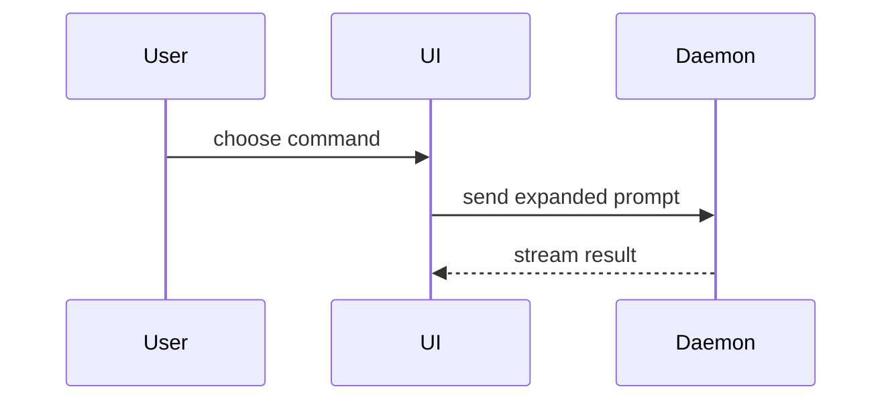

# Show Me

Help the user understand the current topic visually. Skip the preamble and keep prose brief. Pick the smallest view that makes the key point clear, and place each view next to the short text it supports.

## Text views

These render in any client.

- Show logic or an algorithm as pseudocode:

```text
on(save)
  if content is unchanged
    return cached result
  write new content
  return fresh result
```

- Show runtime control flow as a call tree:

```text
submitForm
  createSession
    persistPrompt
    launchAgent
  navigateToSession
```

- Show UI structure as a component tree, including the state and module boundaries that matter:

```tsx
<SessionPage> (apps/example/src/routes/session.tsx)
  useSessionEvents()
  <SessionToolbar>
    <RunSkillButton> (packages/ui)
```

- Show file responsibility or a broad refactor as a shallow file tree:

```text
src/
├── commands/       # parses user actions
├── sessions/       # owns session state
└── transport/      # sends API requests
```

- Show a compact comparison as a Markdown table.

## Changes to an existing shape

Use `diff` when the point is what changes and the surrounding shape already exists. Diff the same shape the topic uses: a component tree, file tree, call tree, or control flow.

```diff
 submitForm
   createSession
     persistPrompt
+    expandSkillMention
     launchAgent
-  navigateToSession
+  navigateToSession
+    subscribeToEvents
```

```diff
 src/
 ├── commands/
+│   └── show-me.ts       # expands the slash command
 ├── sessions/
-└── transport.ts
+└── transport/
+    ├── client.ts
+    └── stream.ts
```

Show the whole block instead when most of it is new, when omitted context would hide ownership or order, or when the user needs a copyable target shape.

## Mermaid

Use Mermaid when labeled nodes and edges explain interaction, control flow, or data flow better than an indented tree, such as messages between several participants or a state machine. A terminal shows Mermaid only as source, so keep diagrams small enough to read as text.



## HTML page

For a UI layout, mockup, state comparison, or concept too dense for text or Mermaid, write one focused, self-contained HTML file: a diagram, an infographic, or a short slide deck, whichever fits the point.

- Match the product's colors, type, spacing, and components when depicting a product; otherwise use a restrained neutral style that works in light and dark. Use real labels and data, and support narrow and wide widths.
- For charts, follow the `dataviz` skill.
- Inline CSS and JavaScript. Load libraries from a version-pinned CDN only when they materially help.
- Write it to a new `mktemp -d` scratch directory unless the user asks to keep it, in which case follow the target project's conventions.
- Open it where the user can see it: the client's built-in browser when it has one, otherwise the platform opener (`open` on macOS, `xdg-open` on Linux). Always give the user its path too.
- When you can render or screenshot the page, look at it before replying and fix overlap, clipping, and overflow.

## Guidance

Keep only the calls, files, props, states, and boundaries needed to answer the user's current question or resolve the current discussion point. Combine views only when each answers a distinct part of the question; you will rarely need more than two.

Keep the result in the conversation by default. Do not persist a visual merely because it is polished, and do not treat a request to save a page locally as permission to commit or publish it.

A requested website, component, or application change belongs in the target project with its normal workflow, not in a `show-me` page.
